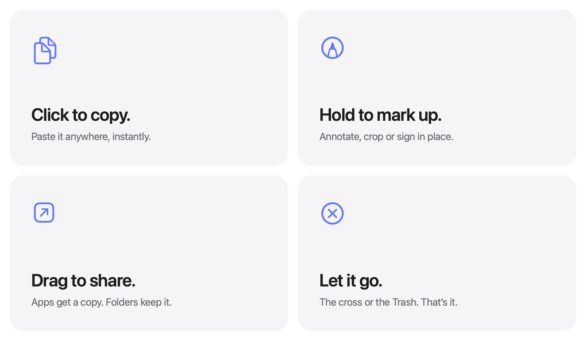

<picture>
  <source media="(prefers-color-scheme: dark)" srcset="docs/images/hero-dark.png">
  
</picture>

<p align="center">
  Free and open source. For macOS 14 and later.
  <br>
  <a href="../../releases/latest">Download&nbsp;&rsaquo;</a>
  &nbsp;&nbsp;
  <a href="#build-from-source">Build from source&nbsp;&rsaquo;</a>
  <br>
  <a href="https://mgrd281.github.io/Screenshots/">Website&nbsp;&rsaquo;</a>
  &nbsp;&nbsp;
  <a href="https://mgrd281.github.io/Screenshots/privacy.html">Privacy&nbsp;&rsaquo;</a>
  &nbsp;&nbsp;
  <a href="https://mgrd281.github.io/Screenshots/support.html">Support&nbsp;&rsaquo;</a>
  <br><br>
  English&nbsp;·&nbsp;<a href="docs/i18n/README.es.md">Español</a>&nbsp;·&nbsp;<a href="docs/i18n/README.gl.md">Galego</a>&nbsp;·&nbsp;<a href="docs/i18n/README.fr.md">Français</a>&nbsp;·&nbsp;<a href="docs/i18n/README.pt-BR.md">Português (Brasil)</a>&nbsp;·&nbsp;<a href="docs/i18n/README.ja.md">日本語</a>&nbsp;·&nbsp;<a href="docs/i18n/README.ko.md">한국어</a>&nbsp;·&nbsp;<a href="docs/i18n/README.zh-Hans.md">简体中文</a>&nbsp;·&nbsp;<a href="docs/i18n/README.tr.md">Türkçe</a>&nbsp;·&nbsp;<a href="docs/i18n/README.az.md">Azərbaycanca</a>&nbsp;·&nbsp;<a href="docs/i18n/README.hi.md">हिन्दी</a>
</p>

<p align="center">
  <a href="https://trendshift.io/repositories/287033?utm_source=trendshift-badge&amp;utm_medium=badge&amp;utm_campaign=badge-trendshift-287033" target="_blank" rel="noopener noreferrer"></a>
  <a href="https://trendshift.io/repositories/287033?utm_source=trendshift-badge&amp;utm_medium=badge&amp;utm_campaign=badge-trendshift-287033" target="_blank" rel="noopener noreferrer"></a>
</p>

<br>

## Out of sight. Within reach.

Every screenshot you take hangs on a line just above your screen.
Rest the pointer in the menu bar and it glides down. Move away and it's gone.

During a call, in Zoom, Teams, FaceTime or the browser, the line stays up
unless you bring it down with the shortcut or the menu, the send button
over chats stays away, and nothing of Snapfly shows in what you share.
Snapfly only asks the Mac whether the microphone is in use; it hears
nothing. Not during a call, in Settings under Line, turns this off.

<picture>
  <source media="(prefers-color-scheme: dark)" srcset="docs/images/demo-dark.gif">
  
</picture>

<br>
<br>

## A gesture for everything.

<picture>
  <source media="(prefers-color-scheme: dark)" srcset="docs/images/bento-dark.png">
  
</picture>

<br>
<br>

| | |
|:--|:--|
| Click | Copy the image. |
| <kbd>⌘</kbd>-click several, or click the circle on each | Pick them, to send or copy just those together. They stay picked, even when the line goes up, until they are sent. All Photos › Pick All in a photo's menu, then put back the few that should stay. |
| Right-click, then Copy Text | Copy the words in it, to paste as text. |
| Right-click, then Copy Link | Upload it as it leaves the line, covered, and copy a link to paste anywhere: a message, an email, a ticket. The link works for seven days, then the file is deleted; the same photo keeps its link. Delete Link takes it down sooner. Recordings and PDFs too. |
| Right-click, then Edit › Crop…, or <kbd>⌥</kbd>-click | The photo opens large over the dimmed screen: drag over the part to keep, and it is kept when you let go. Return keeps the whole photo, Escape cancels. It goes out cropped, and the line shows it so; the file stays as it is. Keep Whole Photo, in the menu of a cropped photo, takes the crop away. Either way, a note offers to undo it for a few seconds. |
| Right-click, then Edit › Hide Part | Click a word to hide it, or drag a box over anything the covering missed. It stays hidden in whatever leaves the line, and a note offers to undo it. Always cover, under the word just hidden, covers that word in every photo from then on, as a rule of your own under Privacy. |
| Right-click, then Edit › Draw on Photo | Point things out with an arrow, a box, a red circle, a highlight, numbered steps or words, and crop it to the part that matters. It is drawn on whatever leaves the line; the file stays as it is. |
| Right-click, then Edit › Background… | Set it on a colour, with room round it, rounded corners and a soft shadow, square or the shape a post or a story wants, so it looks finished in a post, a shop or a slide. It goes out that way; the file stays as it is. Remove Background takes it off again. |
| Right-click, then Save and Export › Convert to SVG | Draws the photo again as shapes that stay sharp at any size, to paste into a design app or save as an `.svg` file. It is made from the copy that leaves the line, so what is covered is covered in it; the file stays as it is. |
| Right-click, then Save and Export › Save Copy… | Keep a drawn on, cropped or covered photo as it goes out, as a file of its own, where you choose. The original stays as it is. A note says where it went; click it to see the file in Finder. |
| Right-click, then Text and AI › Translate Text | Read it in your language, to copy or send. |
| Right-click, then Text and AI › Describe | A line about what it shows, to send along with it. |
| Right-click, then Text and AI › Write a Reply | A reply to the customer in the screenshot, written by Claude or ChatGPT with your own key, ready to send. Type what to add, like "offer a replacement", and it writes it again. |
| Right-click, then Text and AI › Explain with Claude | What the screenshot shows and what matters in it, in your language. Type a question about it, and it answers. ChatGPT, when it is the assistant chosen. |
| Press and hold | Open its menu, as a right-click does: Make PDF, Markup and the rest. |
| Click the paper plane on a photo | Send it straight into the app in front, like a chat. Sent, it leaves the line. |
| Click ChatGPT, Claude, WhatsApp, Gmail, GMX or WEB.DE, in the row under a photo | Send it, or the photos picked with it, there: the website opens in your browser (a new message in Gmail), or, with it already open in the browser in front, they go there, and the photos are pasted in. GMX and WEB.DE open the mailbox: the covered photo is copied for you to paste into a new message, and stays on the line. WhatsApp, Gmail, GMX and WEB.DE show their logos; ChatGPT and Claude show their app's own icon from your Mac, else a short mark. Each icon has its own row in Settings, under Line › Icons under photos: its switch, and Browser or App, to open its website or its own app, when that is on your Mac. Websites open in picks the browser, your Mac's default or another. Click the icons there to turn them on or off, and drag them into the order you want them under each photo. Twelve more wait there to be turned on: Perplexity, Grok, DeepSeek, Qwen, Messenger, Instagram, Outlook, Yahoo Mail, Facebook, Airbnb, Visual Studio Code and Antigravity. Turn on as many as you like: six fit under a photo, and with more, the last place is ⋯, which lists the rest. Instagram, Outlook, Yahoo Mail, Facebook, Airbnb, Visual Studio Code and Antigravity open like GMX: the covered photo is copied for you to paste. |
| Right-click ChatGPT or Claude under a photo | Ask a question with it: the photo goes into the chat with the question after it, like "Summarize this in a few lines". Ask AI in a photo's menu does the same, for each AI chat. The questions are yours to write in Settings, under Line. Your prompts are there too, by their numbers. |
| Click a number beside the send button over an AI chat | The photos go in with that prompt after them, as one message waiting for Return. Point at a number to see its name. Only over ChatGPT, Claude and the other AI chats. |
| Double click | Open it in Preview. |
| Force click | Take a quick look. |
| Right-click, then Keep on Top | Float it over every app in a small window of its own, to read from while you write in a chat. Drag it anywhere, resize it at its edges, and close it with its cross. Up to three float at once. |
| Drag along the line | Move it among the others. Send all, Copy all and the send buttons keep that order. |
| Drag into an app | Send a copy. It leaves the line, as anything sent does. |
| Drag into a folder | Keep it there. It leaves the line. |
| Drag to the Trash, or click the cross | Let it go. With the cross, Take down, Move to Trash or the trash on the tag, a note above the Dock offers it back for a few seconds: a click hangs it on the line again, out of the Trash too. |
| Click the send button on the tag at the end of the line | Paste the photos picked, or all of them, straight into the app in front, like a chat. |
| Click the send button over a chat | The same, without leaving the message box. Drag it to move it; it stays there for that app. |
| <kbd>⌘</kbd>-click two or more, then the combine button on the tag | Join them into one image, ready to send. |
| Right-click a photo or PDF in Finder, then Services › Hide Private Details with Snapfly | Choose what to hide, then send the covered copy straight to Gmail, WhatsApp, ChatGPT, Claude or any chat on for photos, copy it, share it with the Mac's Share menu, or save it beside the original. The original stays as it is. Several files, or a folder, open Cover Files. |
| Right-click (or control-click), then Save and Export › Make PDF | Put the photo, or the ones picked with it, in one PDF, a page each and private details covered. It hangs ready to send, marked PDF. |
| <kbd>⌘</kbd>-click one or more, then the PDF button on the tag | The same PDF, from the tag, where search sits while nothing is picked. |
| Click the download arrow on the tag, above the trash | Save the photos picked, or all of them, into Downloads as they leave the line: covered, drawn on and cropped, each as a file of its own. They stay on the line, and the files they came from stay as they are. A note says where they went; click it to see them in Finder. The App Store edition asks once which folder they go to. |
| Click the trash on the tag | Take everything down at once, but for the photos pinned. |
| Right-click, then Pin | Keep it on the line: clearing it or filling it leaves it there. Click its pin to let it go again. |
| Click the magnifying glass on the tag | Search the words in every photo. Matches stay bright, marked where they say it, and Return picks them, ready to send. |
| Drag the arrows on the tag | Move the line further down the screen, or back up. It stays there. |
| Hold the arrows on the tag a moment, then drag | Move the line anywhere: left, right, up or down. The arrows turn into four, a Force Touch trackpad taps, and the line follows the pointer. Near the middle of the screen, or the top, it snaps into place. On a rope or a wire the photos slide along it and the tag stays at its end. It stays there, on any screen. VoiceOver has Move Left, Move Right and Back to the Middle. |
| Rest the pointer in the menu bar | Bring the line down on that screen. |
| Drag photos or PDFs to the top of the screen, or onto the menu bar icon | Hang them on the line, to send with their private details covered. The files stay where they are. |
| Right-click photos or PDFs in Finder, then Services › Send Safely with Snapfly | The same, from Finder. Open With › Snapfly does it too. |
| Add Files… in the menu bar | Pick photos or PDFs to hang. |
| Cover Files… in the menu bar, or several files or a folder sent to Hide Private Details with Snapfly in Finder | Cover private details in many PDFs and pictures at once, even a thousand. Choose what to cover, like names alone; each gets a covered copy in a new folder, and the files themselves stay as they are. |
| Click anything in the menu bar | Put it away. |
| Glance at the Snapfly icon in the menu bar | How many photos hang, beside it, and a small dot on it while something new hangs that the line has not shown yet. Turn it off with Count on the menu bar icon, under Line. |
| Record a Guide in the menu bar, then click through | Each click becomes a step of a guide, with a screenshot and a sentence. Click the capsule above the Dock to finish, and the guide opens to edit, send or save. |
| Click the Snapfly icon in the menu bar | The menu: how many photos hang and Paste into the app in front, then Settings and the screenshots folder, the ways to take, Add Files and Cover Files, the line, the Hide private details, Screenshot Button and Hide Desktop Icons switches, then the Introduction (Continue Introduction when it was ended before its end), Help & Support and Check for Updates, just above Quit. |
| Check for Updates… in the menu bar | The download edition fetches the newest version, checks it is signed by Snapfly's developer, and after a question replaces itself and opens again. The App Store edition opens TestFlight or the App Store. |
| Hide Desktop Icons in the menu bar | The wallpaper covers the desktop icons on every screen, for clean screenshots and recordings. Choose it again to bring them back. |
| <kbd>⌃</kbd>&thinsp;<kbd>⌥</kbd>&thinsp;<kbd>T</kbd> | Show or hide the line. Change it in Settings. |
| <kbd>⌃</kbd>&thinsp;<kbd>⌥</kbd>&thinsp;<kbd>V</kbd> | Send the newest photo, or the ones picked, straight into the app in front. Change it in Settings. |
| <kbd>⌃</kbd>&thinsp;<kbd>⌥</kbd>&thinsp;<kbd>F</kbd> | Search the words in your screenshots. Change it in Settings. |
| <kbd>⌃</kbd>&thinsp;<kbd>⌥</kbd>&thinsp;<kbd>S</kbd> | Take a screenshot: click what is outlined (scroll for a bigger or smaller part), drag over an area, click a window, or press Return for the whole screen. Change it in Settings. |
| <kbd>⌃</kbd>&thinsp;<kbd>⌥</kbd>&thinsp;<kbd>R</kbd> | Record the screen, chosen the same way. Press it again to stop. Change it in Settings. |
| <kbd>⌃</kbd>&thinsp;<kbd>⌥</kbd>&thinsp;<kbd>P</kbd> | Capture the whole page in the window in front, from top to bottom. Change it in Settings. |

<br>

## Your Desktop. Finally clear.

Hand Snapfly your screenshots<sup>1</sup> and they skip the Desktop
entirely. No floating thumbnail. No five-second wait. Each capture hangs
the instant you take it, and only what you drag out is kept.

Screen recordings hang there too, with a play button over them.
Press and hold one, then Trim, to trim it.

Same shortcuts. Same muscle memory. Just less mess.

The send button on the tag pastes the photos straight into the app in
front, like the message box of a chat: the ones you <kbd>⌘</kbd>-clicked,
or all of them, and they fly over and land where you were typing. It works
by pressing <kbd>⌘</kbd>&thinsp;<kbd>V</kbd> there for you,
so macOS asks for the Accessibility permission the first time.

Every permission Snapfly uses sits in one place: Settings › Permissions.
Screen Recording (for its own screenshots and recordings), Accessibility (for
the send buttons) and each browser (for the chat button on chat websites),
each with what it is for, whether it is given, and one button that asks for it
or opens the right page of System Settings. It updates as you switch things
in System Settings. Each is asked for only when what needs it is first used,
and once one was refused, Permissions Needed… appears in the menu bar.

Help sits beside it, in Settings › Support: the support page, Report a
Problem and Suggest a Feature, which open an email with the version, macOS
and permission details already in it, and those details to copy for any
other way of asking. Nothing personal is in them.

While photos hang, the same send button waits over the chat itself, just
above its own send button: in ChatGPT, Claude, WhatsApp, Messages, Telegram
and other chat apps, and in Safari, Chrome and other browsers only on chat
websites like chatgpt.com, claude.ai or web.whatsapp.com. Email counts too:
Mail and Outlook, and Gmail, Outlook on the web, Yahoo Mail, Telekom Mail,
WEB.DE and GMX in a browser, where the photos go into the message being
written. Settings lists
the apps, by name and icon, and the websites; turn any off, remove it, or add
your own. To know the page, Snapfly asks the
browser, and macOS asks you once whether it may. It shows the newest photo and how many
will go. One click and they are in, without a trip to the top of the screen.
Over the chats it knows, like ChatGPT, Claude, Gemini, WhatsApp, Telegram
or Slack, it finds that spot by itself, measured on each one: on a new chat,
whose message box sits in the middle of the page, it sits higher than once
the chat has started. Drag it where you like it; it remembers the spot for
each app, and for a new chat apart. Press and hold it, or right-click and
choose Send with a Message…, to write a line like "Here is your invoice":
Return sends the photos with the message after them, as one message. The
last five messages wait above the empty field: click one, or press ↑ and ↓,
to send it again; its cross takes it off the list. Above them wait your
saved messages, written under Saved messages in Settings, under Line, like
"Here is the invoice for your order {order}": {order}, {total}, {date},
{name} and {tracking} fill in from the newest photo, read on your Mac. A
blank of a kind you cover stays empty, shown as "…", so the message never
says what the photo hides, and nothing goes until you press Return. To
write in your language and send in your customer's, choose a language with
the globe in the bar, on macOS 15 or later: Return first translates the
message there, on your Mac, so you can read it, and the next Return sends
it. The bar keeps the language for each chat. In Settings,
under Line, choose where it sits (above the chat's send button, a corner of
the window, or the edge of the screen), how it looks, its icon and its color,
with a preview, or turn it off.

<br>

## Or take them with Snapfly.

Press <kbd>⌃</kbd>&thinsp;<kbd>⌥</kbd>&thinsp;<kbd>S</kbd>, or choose Take Screenshot
in the menu bar. The screen holds still. Drag over an area, click a window,
or press Return for the whole screen; Escape cancels.

Smart selection finds what you mean. The picture, card, button or paragraph
under the pointer is outlined, and a click takes just that: one logo out of
a page of search results, without dragging. Scroll, or press ↑ and ↓, for a
bigger or smaller part, up to the window and the whole screen. A drag keeps
to the edges of what is on screen, and when you let go, the empty space
round it is cut to an even margin. Hold ⌘ to drag freely. Crop… does the
same on a photo. Turn it off in Settings, under General.

The screenshot flies
from where it was taken straight onto the line, with nothing to set up in the
Screenshot app first. macOS asks for the Screen Recording permission the
first time.

Faster still: the screenshot button, a small round button at the edge of the
screen, takes one in a single click. In Settings, under Line, choose what a
click does (choose an area, take the whole screen at once, or take the last
area again), its icon and its color, with a preview. Drag it anywhere, right-click it for the rest, or turn it off with
Screenshot Button in the menu bar. While the screen is recorded, it is the
stop button.

For a menu that closes when you press a shortcut, choose Take Screenshot with
Timer, then 3, 5 or 10 seconds. Choose what to take, open the menu, and a
countdown above the Dock takes it when it runs out. A click on the countdown
cancels it. If something goes wrong anywhere in Snapfly, a short note above
the Dock says what happened, instead of a beep.

Press <kbd>⌃</kbd>&thinsp;<kbd>⌥</kbd>&thinsp;<kbd>R</kbd>, or choose Record
Screen, to record an area, a window or the whole screen. A capsule above the
Dock shows the time; click it, press the shortcut again, or choose Stop
Recording in the menu bar to stop. The recording hangs on the line, ready to
trim or send. Make GIF in its menu turns it into a looping GIF that every chat
plays, which hangs next to it and stays animated when sent. Snapfly's own
line and controls stay out of it.

A recording has sound when you choose it, in Settings › General under Screen
recordings: the Mac's sound, what you hear without Snapfly's own; the
microphone, your voice, asked for the first time and on macOS 15 or later;
or both, mixed into one track that every player and chat plays. It has none
until chosen. If the microphone isn't allowed, the recording goes on without
it and a note says where to allow it.

Hide Desktop Icons, in the menu bar, lays the wallpaper over the icons on
every screen, so screenshots and recordings show a clean desktop. Windows
stay above it and clicks go through it; the icons and files stay where they
are and come back when you turn it off. It stays on until you do, even when
Snapfly opens again.

<br>

## Copied images too.

Take a screenshot with <kbd>⌃</kbd> held, or copy an image in Preview, and it
hangs on the line like any other. Turn on Hang copied images in Settings
and the photo on the line in the menu bar fills in while it is on. Only images: anything copied along
with text or a file, and anything a password manager marks as private, is
left alone.

<br>

## Private details, covered.

At the top of Privacy in Settings, one quiet line says how much was
covered lately: "In the last 7 days, Snapfly covered 143 details in 38
photos you sent." Only those counts are kept, for two weeks.

Choose under Privacy in Settings what to cover, in six groups. People:
names, addresses, emails, phone numbers, usernames and faces. Companies and
organizations: a shop, a practice, a bank or an insurer by its name. Money:
bank cards and accounts (crypto wallets too) and amounts. Health: health
details. Documents: ID and tax numbers, QR codes and barcodes, order and
customer numbers, tracking numbers, dates and links. Passwords and access:
passwords and codes (Wi-Fi passwords and licence keys too), API keys and
tokens, and IP addresses. Check All,
Recommended and Uncheck All set the whole list at once; the recommended
kinds are the ones private in nearly every screenshot, and the amount or
the date a screenshot is often sent for wait to be chosen. Whatever leaves
the line, copied, sent or dragged out, has them covered, and the line shows
each photo that way too, so what you see is what goes, with a small lock on
each one that has something covered. Rest the pointer on the lock, or open
the photo's menu, and it says what was covered, like Names · QR codes and
barcodes; VoiceOver says it too. On the lock, the photo also shows where:
the rest of it dims, and each covered place is outlined. Copy Text leaves them out too. Anything
it misses, hide by hand with Edit › Hide Part in a photo's menu: a click on a word
hides it, and Always cover hides that word in every photo from then on. Labels like Billing
address, Customer, Recipient, Kundennummer or Diagnosis tell it where a whole
block is private, on their own line or as a card's heading, like Kunde on a
shop's order page. On a form or an invoice, with the labels in one column and
the values beside them, like Vorname:, Nachname:, Adresse:, PLZ: and Stadt:
on a marketplace's order, each value on the label's row is covered, and the
first and last name found there are covered wherever they appear together.

Names means people's names, and nothing else. A label's value is cut where
the name ends: "Patient: Mustermann, Max, geb. 01.02.1960" covers
"Mustermann, Max" and leaves the date to Dates. A company, a practice or a
bank is never covered as a name, a title like Dr. med. or Frau stays
readable, and so do a phone number, an address, an amount or a diagnosis,
each a kind of its own. A line that only looks like a name, with nothing to
vouch for it, is offered to check; in a doctor's letter, an invoice or a
bank statement it is covered and marked to check instead, so a patient's
name never stays readable as a mere suggestion.

Printed forms are read field by field, as a person reads them: each label,
and its value after it, beside it, or under it in its column, on one line or
several, even where a row of labels and a row of values are read as one
line each. A value is what its label says it is, not what it looks like. On
a German sick note (Arbeitsunfähigkeitsbescheinigung), a prescription or a
referral, the name under "Name, Vorname des Versicherten" is the patient's
name, on one line or two, and the lines after it the address; the date under
"geb. am" is a date; the numbers under Versicherten-Nr., Kostenträgerkennung,
Betriebsstätten-Nr. and Arzt-Nr. are ID numbers; the insurer under
"Krankenkasse bzw. Kostenträger" is an organization; and the dates after
"Arbeitsunfähig seit", "voraussichtlich arbeitsunfähig bis" and
"festgestellt am", and what stands under "AU-begründende Diagnose(n)", are
health details. So each kind covers its own fields and no other's: Names
alone leaves the diagnosis, the dates and the numbers readable, Health
alone leaves the names, and a label itself is never covered. What a field
holds also wins over what it looks like: a disease named after a person
under Diagnose is no name, and an insurance number no phone number. A
value that fits its label only in part, like a name read in small letters,
is covered and marked to check; one that barely does, like a number too
short for its field, is only offered.

Names covers everyone's names. Two more choices sit under it, for when
Names is off: Patient names, the patients' alone, and Other people, the
doctors, customers, staff, payees, senders and recipients. Patient names
starts on, as a patient's name is health data. Whose a name is comes from
what stands round it: a label like Patient:, Pat., Name des Versicherten
or Behandelnder Arzt:, a title, the address under "Herrn" in a doctor's
letter, the letter's subject, words like "Ihren Patienten" before it in a
sentence, a date of birth after it, a table's header above it, and the
closing above a signature, which makes the one who signs a doctor. Once a
name is known as the patient's, every place it appears is, in either
order, with an initial, or with a letter misread. A name whose role is not
clear is covered anyway and marked to check. None of these ever covers a
phone number, an address or a QR code: a code is covered by codes, or by
another kind it holds, like the account in a payment's code, never by a
name or a company in it.

API keys and tokens are found by how services start them, like `sk-`,
`ghp_` or `AKIA`, by what follows Bearer or a setting like `API_KEY=`, by a
private key's first line, and by any long run of letters and digits that
reads as chance made it, which a name in code or a commit's number does
not. IP addresses are both kinds, IPv4 and IPv6, read as the system reads
them, so a time like 12:30:45 or a version like 1.2.3.4.5 is left. A map's
coordinates are covered as an address.

Choose how covers look under Cover look: ink, as always; labelled, the ink
with what it hides named on it, like Name or Phone; blur; pixels; dots, as
a password field shows; or erased, as if nothing had been there.
Each tile is a little chat covered by the same code as a copy. Every look
hides for good: blur, pixels, dots and erased are drawn from the colors
just around what is covered, never from it, so unlike a real blur or
pixelation of text, nothing covered can be brought back. Draw on Photo shows
the look you chose; Hide Part shows ink while you draw. Keep the last four
digits leaves a card, account or phone number recognisable, as on a bank
statement: "•••• 1111". It holds for copies and for Copy Text alike.

Every copy is checked before it leaves: once covered, it is read again as
anyone could read it, and whatever private still shows, or any piece of what
was hidden left beside its cover, is covered too. Under Protection, Find more
with Apple Intelligence (on where the Mac has it) lets the model on the Mac
read the words as well and cover what the patterns miss, like a name in a
sentence; it only ever adds covers, and nothing leaves the Mac. Find more
with Claude, or ChatGPT, does the same with the AI assistant set up in its
own pane: it is off until you turn it on, since it sends the words of each
screenshot to Anthropic or OpenAI. Strongest protection covers every line
with something private whole, with more room around it, so not even how
long it was shows. The room round a cover never reaches into a line above
or below that is not covered: a name is hidden, and the street under it
still reads in full.

QR codes and barcodes are covered whole, since nobody can read what they
hold: a payment, a sign-in, a ticket or a parcel. The number printed under
a barcode goes with it. Turned off, a code is still covered when what it
holds is a kind you chose, like the IBAN in a payment code under bank
accounts or a link under links. A kind added in an update starts on when it
is recommended and you cover anything; turn it off and it stays off.

To see what each kind hides, Test on a Sample under Privacy covers a
made-up order confirmation with what you checked: an order number, a
name, an address, an email, a phone number, an IBAN, a tax number, a
tracking number, a PIN, an API key, an IP address, a username, a total, a
date, a link, a medicine and a QR code. It says what was covered there, and what you checked that
the sample does not show. It speaks for that sample only; a real
screenshot can read differently.

Under Also hide, add rules of your own: a word, like your shop's name,
covered wherever it appears; a label, like Customer number, whose value is
covered, on its line or the line below; or, for whoever knows them, a
pattern. They apply to everything that leaves the line, and to the copies
saved from Finder.

Whatever picture leaves the line is a fresh file: what it shows, without
the notes a file carries on when, where and with what it was made, or the
Finder's note of where it was downloaded from. A PNG stays a PNG, pixel for
pixel; a photo goes as a JPEG; a GIF goes as itself, so it keeps moving.
Turn on Plain file names under Privacy, and pictures are called Image too,
rather than after when they were taken.

To cover a whole folder, turn on Cover what lands in a folder under
Privacy and choose two folders, like the one invoices are downloaded to
and another for the copies. Every picture or PDF that lands in the first
gets a copy with what you checked covered, saved under its name in the
second, one after another in the background. A note says how many were
saved, and names the files where nothing was found, so you can take a
look. What was in the folder before stays as it is.

AI chats may keep what goes into them on their servers. Turn on Cover
everything in AI chats under Privacy, and whatever you send, copy or drag
out while ChatGPT, Claude, Gemini or another AI chat is in front, as an app
or a website, has every kind covered, checked or not; Copy Text,
translations and the blanks of saved messages leave them all out too. It
only ever covers more than you chose, and the line still shows your choice.
Over an AI chat, the send button shows a small lock by the count meanwhile,
and Sent in the History lists what was covered.

A click on a chat's icon, or on the send button, sends at once. Turn on Check
before sending, under Privacy, and before photos go into an AI chat, or an app
or website Snapfly doesn't know as a chat, a card shows them as they will go,
what is covered in them, and when photos like them were sent before. Return
sends them, Escape keeps them on the line. Choose every time instead to see
the card before every send.

Hide Part opens wide: the picture on the left, as large as fits, and on the
right everything to choose; drag a corner to make the window larger or
smaller. There you can also say what to hide, like "everything but the amount
and the date" or "the customer's name", or click one of the examples under the
field. Apple Intelligence picks the lines, or just the words in them, on your
Mac, and they show as boxes to check before you press Done; click one to show
it again. Without Apple Intelligence, type words separated by commas and they
are hidden wherever they appear. The text is read on your Mac, and the
screenshot file itself is never changed.

<br>

## Pointed out, before it goes.

Edit › Draw on Photo, in a photo's menu, opens the same wide window to point
things out: an arrow from where it starts to what it points at, a box round
a button, a circle round a line, drawn in red as a pen draws one, a
highlighter over a line of text, numbered steps clicked one after another,
and words on a label. Crop keeps only the part that matters. Each tool has
its key: V selects, A draws arrows, R boxes, O circles, H highlights, N
numbers, T puts words down and C crops, and the last tool you drew with is
ready the next time. Click a drawing to change its colour or size, drag it
or its handles, or press Delete; ⌘Z undoes.

Edit › Background… sets the photo on a colour, ready for a post, a shop or a
slide: one of eight, from the warm colours of Snapfly's icon to calm grey
and white, with the room round it and how round its corners are on sliders,
a soft shadow, and the shape of the whole picture: round the photo, square,
16:9, 4:5 or 9:16, with the photo in the middle. The window shows it as it
will go out, covered and drawn on, and the next photo starts from the last
background chosen. Remove Background, in the same menu, takes it off.

Only the crop, quicker: choose Edit › Crop… in a photo's menu, or ⌥-click the
photo. It opens large over the dimmed screen; drag over the part to keep,
and it is kept as you let go, with whatever you drew on it. Or click the
part outlined under the pointer. Return keeps
the whole photo, and Escape, a right-click or a click beside it cancels. A
note says the file stays as it is, and Keep Whole Photo, in the menu of a
cropped photo, takes the crop away.

What you draw goes on the copy that leaves the line, over what is covered,
and the line shows the photo that way. The file itself stays as it is, and
the drawing stays with the photo until it leaves the line. Drawing explains
a picture; it never hides anything, so the lock counts only what is
covered.

Every edit says where it went. Done says the drawing is kept with the
photo, and Save Copy…, under Keep as a file in the window, keeps the photo
as it goes out as a file of its own, wherever you choose; a photo's menu
has it too, under Save and Export. Markup and
Trim write over the file itself, and the note after them names its folder,
"Saved to Pictures › Snapfly"; a click on the note shows the file in
Finder.

<br>

## Shapes, not pixels.

Save and Export › Convert to SVG, in a photo's menu, draws the photo again as shapes: flat
areas of color with lines and curves for their edges, which stay sharp when
they are made as large as a wall. It opens the same wide window: your photo
and its SVG one over the other on the left, under a divider to drag, and
the choices on the right. Zoom in with a pinch, ⌘-scroll or the buttons under
the picture, to see how close the edges are; a double-click looks closely at a
spot.

Pick the kind of picture, and the rest follows: Screenshot for interfaces and
text, Logo or icon for a few colors and smooth shapes, Illustration for artwork
with many flat colors, Photo for many soft colors, and Black and white for
only the dark lines, with nothing behind them. Then Colors, Smoothness and
Leave out specks go further, and the result shows how many colors, shapes
and bytes it came to. Copy SVG puts it on the clipboard for Figma, Sketch or
Illustrator; Save SVG… writes a file where you choose.

A straight edge stays a straight line and a corner stays sharp, so a button
comes out as four lines, and what is round becomes a few smooth curves. It is
made on your Mac and nothing is sent anywhere. Like everything that leaves the
line, it is made from the copy with the private details covered, so a covered
word is a covered shape in the SVG; the file itself is never changed. A
gradient becomes bands of flat color, and a photograph becomes a
poster of it, so a photo's SVG is large; a picture of more than twelve
million pixels is traced smaller and the SVG still opens at its own size.

## Step by step, by itself.

Record a Guide, in the menu bar, turns what you click into a step-by-step
guide. Click through what you want to show, the way you always would: each
click is a step, with a screenshot of that moment and a sentence saying what
to do, like "Click “Orders”.", "Choose “Export…”." or "Click the “Search”
field.", from what the app says is under the pointer. A ring spreads where
each click lands, so you know it counted, and the capsule above the Dock
counts the steps; click it to finish, or choose Cancel Guide in the menu bar.
Nothing you type is recorded, and Snapfly's own windows stay out of the
screenshots.

The guide then opens in a window of its own. Give it a title, read the steps
through and write any sentence again, move a step up or down, or delete it.
Each step shows the part of the screen around its click, with what was
clicked boxed in red; Show Whole Screen shows all of it. Every screenshot has
its private details covered, as chosen under Privacy, before you see it, and
a name that could be private, like a customer's name or an order number,
stays out of the sentences.

Hang on the Line makes it a PDF of numbered A4 pages and hangs it, ready to
send. Save writes a PDF, or one tall picture that shows whole in a chat, or
copies that picture. The last 20 guides stay on your Mac, under Recent
Guides in the menu bar. The App Store edition can't ask other apps what was
clicked, so its steps say "Click here." and mark the click with a ring.

<br>

## A folder of its own.

Snapfly can keep your screenshots in a workspace: a folder on your Desktop
named after the app, with a folder inside it for each kind of screenshot.
It is off until you turn it on, in Settings under Workspace. Then each new
screenshot is saved into the category you chose for new ones, Orders,
Customers, Projects, Documents, Other or Unsorted, and still hangs on the
line the same moment. The Desktop is found the way macOS names it, so a
Desktop in another language or in iCloud Drive works the same; with iCloud
Drive, everything in the folder goes to iCloud, covered or not, and Settings
says so beside the switch.

Settings › Workspace lists the categories. Rename one, hide it, move it up
or down, choose which one new screenshots go to, add your own, or remove
one: its screenshots move to Unsorted and nothing is deleted. Rename the
folder or choose Change Location…, or move it in the Finder: Snapfly finds
it again, and what hangs on the line follows its files. The folder carries
Snapfly's icon in the Finder, and looks like any folder if macOS refuses
it. A screenshot is written whole or not at all and never over another file,
and when the disk is full or the folder can't be reached, a note says why
while the screenshot is kept in Snapfly's own folder, so none is lost.

In History, the Workspace page shows them by day as a grid or a list. Pick a
category, search by name or by the words in the photo, press Return or
double-click to open one, and use the menu for Hang on the line, Quick Look,
Copy, Copy File Path, Show in Finder, Move to Folder, Rename… and Move to
Trash. The same Move to Folder is in the menu of a photo on the line.

Delete… in Settings asks first, then moves the screenshots to the Trash, and
leaves any file in the folder that isn't Snapfly's. Only a folder Snapfly
marked as its workspace can be deleted that way, and nothing is ever deleted
by turning the workspace off or removing the app. It isn't in the Mac App
Store edition, whose sandbox can't write to the Desktop.

<br>

## A thousand files, covered.

Cover Files…, in the menu bar, covers private details in many PDFs and
pictures at once. Drop files or whole folders on its window, or choose them,
as many as a thousand and more; folders are opened all the way down, and
files of other kinds are counted but get no copy. On the right, choose what
to cover: Names Only, As in Settings, All, or each kind on its own, from the
same list as Settings › Privacy. Your own rules there apply too.

Cover Files then asks where to save, and makes a new folder there, named
with the day and time, with the folders the files came in kept inside it.
Each PDF is read page by page on your Mac and drawn again with what you
chose covered, and each picture is saved as a covered PNG, a few at a time,
with how far it has got and about how long is left. Stop ends it after the
files being read. The list then shows how each went: covered, with how many
places; nothing to cover, to look at before sending; or not covered, locked
with a password, over 200 pages or unreadable, which get no copy at all.
The files themselves are never changed. Selecting several files or a folder
in Finder and choosing Hide Private Details with Snapfly opens it too.

<br>

## Photos and PDFs too.

Anything you want to send can hang on the line, not only screenshots. Drag
photos or PDFs from Finder, Mail or anywhere else towards the top of the
screen: the line comes down, opens a place for them and hangs them where you
let go. You can also drop them on the menu bar icon, choose Send Safely with
Snapfly under Services in Finder's right-click menu, open them with Snapfly,
or choose Add Files… in the menu bar.

They leave the line the way a screenshot does, protected. The details chosen
under Privacy are covered, and Hide Part works on them too, page by page in a
PDF. A photo goes without where and with what it was taken: its location,
camera and captions stay behind, and it goes as a JPEG. A PDF is read page by
page on your Mac and drawn again into a new PDF, so what is covered is gone,
not painted over, and no text, links or document details come along. Each
copy is opened again before it is handed out, and one that still carries
text, notes, form fields, an author, a title, a subject or keywords is not
handed out at all. Its card
shows a spinner while its pages are covered, then a lock. The file itself is
never changed. Save Word or Excel documents as a PDF first; a PDF locked with
a password, or longer than 200 pages, stays out.

In Finder, right-click a photo or PDF and choose Services › Hide Private
Details with Snapfly. The window shows the photo, or each page of the PDF:
tick what to hide in this copy, drag a box over anything else, or say what to
hide. Save Copy… puts a covered copy beside the original, under the same name
with "(covered)" added, after you have chosen the place. The original stays as
it is.

<br>

## The whole page.

Press ⌃⌥P, or choose Capture Whole Page in the menu, and Snapfly scrolls the
window in front from top to bottom and joins what it sees into one long
picture, with no seams: the toolbar and a site's sticky header appear once,
at the top. It works in any browser and in any window that scrolls. It turns
the scroll wheel in small turns, as a hand would, and if the page does not
follow the wheel, it presses Page Down instead. The picture hangs on the line
like any screenshot, and with the time stamp on, it is stamped with the time
and the page's address. It needs the permission to press keys, the same one
the send button uses.

<br>

## Stamped with the time.

Turn on Stamp the date and time under General in Settings, and every
screenshot of the whole screen gets a band above it, like a letterhead,
that says when and where it was taken: the date and the time to the
second, from the atomic clock of the PTB in Germany (or the Mac's clock
when there is no connection); the page that was open in the browser; and
the screenshot's SHA-256 fingerprint, so anyone can check the copy was
made from that very file. Choose Every screenshot to stamp all of them,
and type a few words, like your shop's name, to stand before the date.

The screenshot itself stays as it was. A stamped copy is saved next to it,
named "… with time stamp", and the stamp also shows on the line and goes
with whatever leaves it. Asking the PTB for the time is the only thing
Snapfly ever sends out, and only while the stamp is on.

<br>

## Eight ways to hang.

Pick what the photos hang on under Line in Settings: the clothesline,
crooked photos swaying on clips; a glass shelf of Liquid Glass, upright
like the Dock; an island, black and hanging from the top of the screen
like the notch grown wide; a card stack by the right edge that spreads
out as you reach it, with a count on top; a taut wire, the photos straight
on clips; floating, the photos alone with nothing behind them; a
filmstrip, dark with its holes along the edges; or a fan, the photos
arcing down from the middle like cards in a hand. Everything else works
the same on each.

<br>

## Calm for everyone.

Turn on Reduce Motion and the line fades in instead of sliding. Photos stop
swinging and captures appear in place instead of flying. Turn on Reduce
Transparency and the glass turns solid, and the dark badges on photos do too. With VoiceOver,
each photo is a button named after its file. Pressing it copies the photo,
and its actions send, pin and take it down. On macOS 26, the controls that
float over your screen are made of Liquid Glass.

<br>

## Sent, and gone.

Whatever you send into a chat, with a paper plane, ⌃⌥V or a drag, leaves
the line as it lands there, so the line only holds what is still to send.
Pinned photos stay. As they leave, a note above the Dock says where they
went, for a few seconds: "Sent to WhatsApp". Wrong chat? A click on the
note hangs them on the line again. Rather keep them on the line? Turn off
Take photos down once sent in Settings.

A photo that says what one sent lately said gets a paper plane after its
lock, and its menu says where that went and when, so the same invoice isn't
sent twice by mistake. Snapfly knows it again by a print of its words kept
with the History, not by the words themselves. Turn it off with Mark photos
sent before, under Line.

Ten of fifteen to send? Click the circle on each, in the corner opposite
the cross, and only those go: with the send button on the tag, with the one
over a chat, or with ChatGPT, Claude, WhatsApp, Gmail, GMX or WEB.DE under it. Those
send straight there: your browser comes to the front on the
chat it shows, or opens a new one (or their app does, if you chose it); the
photos are pasted in once it is ready, covered as in any AI chat for the
first two, after the check before sending. Their icons stand in a row
under the photo, so the photo keeps only the paper plane; the photo's menu
has them all under Send to: the ones under photos first, the rest under
More Chats. Turn each icon off in Settings, under Line › Icons under
photos, each on its own.

Too large for a chat, or for someone without one? Copy Link, in the photo's
menu, uploads it as it leaves the line, its private details covered, and
copies a link that works for seven days: the page shows the photo, plays
the recording or opens the PDF, with Save beside it, in English, German or
Arabic. Copy Link again on the same photo copies the same link; once it is
covered differently, it gets a new one. Delete Link takes it down at once.
Files up to 95 MB. Nothing about you goes with it, and the file is deleted
after seven days.

Longer instructions you give an AI again and again, like how to write a
reply, are prompts. Over ChatGPT, Claude or any other AI chat, their
numbers stand in a small glass bar just above the send button, 1, 2 and
so on, leaving the button as it was: point at one to
see its name, click it, and the photos go into the message box with that
prompt after them, waiting for Return. Over other chats the numbers stay
away, and a click on the button itself sends the photos alone, as ever.
Two come with Snapfly: Natural writing, which asks for a text that reads
as a skilled person would write it, accurate and in your own voice, and
Reply to a customer. Write up to nine of your own in Settings, under Line
› Prompts for AI chats, each with a title and as long as it needs; they
are in a photo's menu under Ask AI too.

Something to ask about it? Right-click ChatGPT or Claude on the photo, or
choose Ask ChatGPT or Ask Claude in its menu, and the photo goes with a
question after it, like "Summarize this in a few lines" or "What should I
reply to this?"; the chat answers in the language you ask in. The five
questions that come with Snapfly are yours to change under Questions for
ChatGPT and Claude in Settings, under Line. Nothing is sent until you
press Return in the chat.

<br>

## Gone, but not lost.

Taken down by mistake? For a few seconds, a note above the Dock offers it
back, as it does after a crop or a part hidden by hand: a click puts it
back as it was.

Everything that leaves the line, sent or taken down, waits in the History
for 30 days: History… in the menu bar, or <kbd>⌘</kbd>&thinsp;<kbd>Y</kbd>
while the menu is open. It is grouped by day, and the search finds the words
in every photo. A click hangs one on the line again; Send Again in its menu
hangs it and sends it, covered, into the chat you had in front. A screenshot from
Snapfly's own folder moves into its History folder and goes to the Trash once
its days are up; a file from anywhere else stays where it is. Choose 7, 30
or 90 days, a year or forever, or turn it off, in Settings, under Line. It
all stays on your Mac.

Orders, at the top of the window, puts the photos that show an order,
invoice or customer number together under that number, the order with the
newest photo first; search finds an order by its number too.

Sent lists what went into which chat: the date
and time, the photo, the chat (the website in a browser, else the app),
what was covered and the message sent with it. Search it like the photos,
and Export… saves it as a table for a spreadsheet, with semicolons where
numbers use a decimal comma. It keeps only these facts, no pictures, for
as long as the History keeps photos.

<br>

## Order details, ready to copy.

Text and AI › Order Details, in a photo's menu, reads the order a screenshot shows: its
number, the date, the total (the amount by a word like Total or Gesamt,
else the largest), the name, the address, the email, the phone, the
tracking number, and what a QR code says. A payment code, the GiroCode on
European invoices or the Swiss QR bill, reads as the account in groups of
four, who is paid, the amount and the reference, and its amount stands in
for the total when the text shows none. Each part has its own copy
button; Copy All copies them as lines, and Copy Row as one row with a tab
between the parts, always in the same order, to paste into a spreadsheet.
It is read on your Mac as the screenshot shows it, not covered. With the
AI assistant set up, Claude or ChatGPT reads the covered copy too and adds
what your Mac did not find, like what was bought, with the quantity.

For the books, Save for Bookkeeping in the same menu puts the photo,
covered as it leaves the line, in a folder you choose once, under a name
that says what it is, like "2026-10-17 Order 1024 74,00 €", and adds a
line to Snapfly.csv there: the day, the file, the order and the total.
Email to Bookkeeping… puts the covered copy in a new email to whoever
keeps your books, the same name as its subject. Choose the folder and the
address in Settings, under Line. Whatever you cover stays out of the name
and the table too.

For a customer, Send to › Send with Shop Header in a photo's menu sends it covered,
under a band with your shop's name and logo, the order number and the day,
so it is clearly from your shop and still a screenshot. Set the name and
the logo under Line in Settings; the order shows unless order numbers are
covered.

Once a month, Monthly pack in the same place makes one PDF of a month's
receipts for your tax advisor, beside them in the folder: a page listing
each one with its day, order, total, page and fingerprint, the sum of the
totals when they share a currency, then every receipt on a page of its
own. It helps hand them on; it is not an archive of record.

<br>

## Translated and described, on your Mac.

Translate Text reads a screenshot and translates it into the language you
pick, line by line, with Apple's translation. Describe writes a line about
what it shows, like the order and its number, with Apple Intelligence,
ready to send along with the photo. Both start from the text as it leaves
the line, with private details already left out, and neither sends
anything off your Mac. Without Apple Intelligence, Describe uses the
screenshot's title.

<br>

## Claude or ChatGPT, with your own key.

Text and AI › Write a Reply, in a photo's menu, has Claude or ChatGPT write the answer to
the customer in the screenshot: short, friendly, in the language they wrote
in, with [ ] where you have to decide, like a date or a refund. Type what to
add, like "offer a replacement", press Return, and it writes it again. Send
pastes it into the chat in front. Explain with Claude says what the
screenshot shows and what matters in it, in your language, and answers a
question you type about it. Order Details asks it for the parts your Mac
did not find.

Set it up once in Settings › AI Assistant, a pane of its own: click the
Claude or ChatGPT tile, which shows the app's own icon when the app is on
your Mac and whether a key is saved for it, click Get a Key… to make an API
key on their website and copy it, then click the clipboard button beside
the key field, which pastes and saves it in one go (or paste it and click
Save). Snapfly checks the key with them at once, by asking for the models
it may use, which costs nothing: Ready. The key works, or that they did not
accept it. The key stays in your keychain; Settings shows only its last four
characters, with Change and Remove Key beside them, and Check Again checks it
once more. Model is a menu of the models your key may use, by their names,
newest first (Claude Opus 5.5, Sonnet 5.5 and Haiku 5.5 until the key is
checked); Other… takes a model's ID by hand. What it does lists Write a
Reply, Explain and Order Details, and holds the switch Find more with Claude
(or ChatGPT). An AI card whose key is missing or refused opens this pane.

What it is sent is the screenshot covered as for an AI chat, never the
original, and only when you choose one of these. It goes straight from
your Mac to Anthropic or OpenAI, with your own key, and they bill each
request to your account there: a Claude or ChatGPT subscription does not
cover it. Words in the screenshot are only read, never followed.

<br>

## Private by design.

No account. No server of its own. No analytics.
Snapfly runs entirely on your Mac, and your screenshots never leave it
unless you send them, make a link to one with Copy Link, or turn on Sync,
which keeps your iPhone in step through your own iCloud, covered copies only
unless you choose originals too. On its own, the only thing it ever asks the internet is
the time, from the PTB's atomic clock, while the time stamp is on. The AI
assistant, once you give it your key, sends a covered screenshot to Claude or
ChatGPT only when you choose Write a Reply, Explain or Order Details, and
the words of each screenshot only with Find more turned on under Privacy.

<br>

## Mac and iPhone, in step.

Turn on Sync in Settings on the Mac and on the iPhone, signed in to the same
iCloud account, and the two work as one:

- **From the Mac.** What hangs on the line goes to the iPhone as it would
  leave the line, with its private details covered, and shows there under
  From your Mac, ready to copy, share or save to Photos. The whole picture is
  fetched when you open it.
- **From the iPhone.** Send to Mac, under a covered screenshot, hangs it on
  the Mac's line.
- **Originals stay put.** Only covered copies go, unless you choose Originals
  too, and then only those taken from then on.
- **Your devices.** Settings lists them, with when each was last there, and
  says how syncing stands: up to date, waiting for a connection, or what needs
  you. Sync Now tries again what could not go.
- **Another Apple account? Pair with a code.** If the iPhone is signed in to
  a different Apple account than the Mac, click Show Code… in Settings › Sync
  on the Mac. Six digits show, a new one every 30 seconds. On the iPhone, tap
  Connect to a Mac with a Code in Settings and type them; the Mac asks
  whether to connect that iPhone, and only a yes lets it in. The Mac then
  shares its sync with that account alone, through iCloud. Disconnect… on
  either side ends it.

It goes through your own iCloud, never a server of Snapfly's, and a change
made offline waits until it can go. The plan, the rules and what is verified
are in [SYNC.md](SYNC.md). Where Snapfly stands as one Mac and iPhone
product, what is verified and what comes next is in
[ECOSYSTEM.md](ECOSYSTEM.md).

<br>

## On the iPhone.

`iOS/` holds Snapfly for the iPhone. iOS lets no app float over the others or
watch the screen, so there is no line there. What it keeps is the covering:

- **Four tabs** in the system's tab bar, in Liquid Glass from iOS 26 on,
  where it shrinks to the tab shown as a page scrolls down: Photos, Scan,
  Protected and More. Scan opens the system's document camera: a letter, a
  form or a receipt is found, straightened and cropped by itself, and a
  single page opens at once to be covered like a screenshot; several wait
  as small cards, kept in memory only while the app is open. Protected
  shows the last twelve screenshots protected, in the same grid. More holds
  Settings and Help & Introduction. While a picture is open the tab bar
  steps aside.
- **From any app's share sheet.** Share a picture from Photos, Messages,
  Safari or anywhere else and choose Snapfly: it is covered right there, as
  chosen in Snapfly (the kinds, the look and the own rules, which the app
  keeps for its extension in the iPhone's keychain), read again and checked,
  then copied, shared on or saved, without opening the app. Nothing of the
  picture is kept once the sheet closes.
- **The Photos tab** opens on Snapfly's picture of stacked photos, a page, a chat
  and a landscape with a green photo badge, drawn on the iPhone and showing
  no one's details, over Protect a Photo, a green button that opens any
  picture from Photos. Once there are screenshots, the picture turns small
  beside its words and the screenshots come first: what the Mac sent and
  the newest eight in small square
  cards, four to a row, that show when each was taken in a small label, a
  green shield once it was protected, and a ⋯ button with Cover and Copy,
  Share or Save, all of them
  behind See All, which finds them by the words they say (those read ahead
  of time, below), shows only those with private details, protected or not,
  and puts the newest or the oldest first. From iOS 18 on, a screenshot opens by growing out of its
  card. How syncing stands sits beside the name at the top, and opens More.
  Tap a screenshot and it shows at once; what the patterns, the labels and
  the names find is marked a moment later, then the copy is made, read again
  as anyone could read it, and covered further if need be, and where Apple
  Intelligence is on, what it finds joins after (Don't Wait leaves it out).
  Protect Picture is an editor where the picture is the screen: it is
  fitted as large as the floating controls allow, and zoomed in (two
  fingers or a double tap) it scrolls out from under them, so every corner
  stays in reach. A small capsule under the title says how far the
  protection is, then how many places are covered and how many are to
  check, each counted once; while a place to check is not covered the
  picture is never called protected. A tap on it opens Details, which goes
  through the places Snapfly was not sure about one by one, from the top:
  the place itself, what it hides, Keep Covered or Cover, Leave Visible,
  Show on Picture, and how many are checked. Over the bottom float the
  tools in one capsule: Select taps a place to select it, or a word to hide
  it; a selected place moves, resizes by its corners and, a box, turns by
  its handle, and holding one down offers Cover, Uncover or Delete. The
  marker (thin, medium or thick, held for its widths), a box and the lasso
  hide more by hand in solid ink, one finger drawing and two moving the
  picture; the eraser takes covers away, and the picture shows there again,
  in the editor only. Every change can be undone and done again; Clear
  Hidden by Hand and Reset to Suggestions take back many at once. Under
  them, Copy, Share and Save as icons (held, each says what it does; Save
  goes to Photos, or held, to Files), and Send to Mac while a Mac is there.
  Tapped before the copy is ready, a way waits and goes once it is; while
  places are still to check it asks first. Hold the eye to see the
  screenshot as it was. Full Screen, or a tap on nothing, leaves the
  picture alone on black; a tap brings everything back. Hold a screenshot in the grid for Cover and Copy, Cover and Share
  or Cover and Save, without opening it. The screenshot itself stays as it was.
  Settings chooses what to cover, in the same six groups as on the Mac,
  with Check All, Recommended and Uncheck All, and Patient names and Other
  people beside Names. Cover look picks how covers look, from the same six
  as on the Mac, with Keep the last four digits and Strongest protection.
  Reading and checking holds Apple Intelligence, how long the last
  screenshot took, the middle and the 95th percentile of the last fifty,
  and Faster picture processing (below). Under Advanced, add rules of your
  own, as on the Mac, and see how to set up the double tap on the back.
- **Faster picture processing** is off until you turn it on, after a page
  that says what it does. It reads your pictures from the last 60 days on
  the iPhone ahead of time, newest first: the screenshots only, every photo
  Snapfly may see, or only photos you pick. The words read and where they
  are stay on the iPhone, locked while it is, never in backups; a photo
  opened later is covered from them without being read again. It works
  while Snapfly is open, and in the background while the iPhone charges,
  when iOS allows; it never downloads a photo from iCloud, and waits in Low
  Power Mode, when the iPhone is warm or short of memory, and while you
  protect a picture. Its page shows how far it is with real numbers, the
  photos only in iCloud, the last update and the room it takes, with
  Pause, Prepare Now, Delete Local Index and Turn Off, which deletes it.
- **Cover the Latest Screenshot** is a Shortcuts action that needs no opening
  of the app. Chosen for Back Tap (Settings › Accessibility › Touch › Back Tap
  › Double Tap), a double tap on the back of the iPhone covers the newest
  screenshot and copies it, ready to paste into a chat.
- **Cover Private Details** covers any picture a shortcut hands it.

Both apps share the code in `Sources/Tendedero/Shared` (finding and covering
private details, the atomic time, the translations), so an improvement there
reaches both. Everything happens on the device, unless you turn on Sync.

The iPhone App Store workflow builds it, signs it and sends it to TestFlight
whenever it changes on `main`. Its certificate is made once, on a Mac, with
`scripts/iphone-signing.sh`.

<br>

## Tech Specs

| | |
|:--|:--|
| **Compatibility** | macOS 14 Sonoma or later, on Apple silicon and Intel. Designed for macOS 27. |
| **Size** | 1.7 MB |
| **Languages** | English, German, Spanish, Galician, French, Portuguese (Brazil), Japanese, Korean, Chinese (Simplified), Turkish, Azerbaijani, Hindi, Arabic |
| **Built with** | Swift, AppKit and SwiftUI |
| **Network access** | Only the time, from the PTB's atomic clock, while the time stamp is on |
| **Price** | Free |
| **License** | MIT for the code. The name and icon are not included. |

<br>

## Install

Download Snapfly.zip from the [latest release](../../releases/latest), open
it and drag Snapfly to Applications. Builds from `main` are signed with a
Developer ID and notarized by Apple, so they open like any other app.

Each version also keeps a release of its own on the [Releases](../../releases)
page, and [CHANGELOG.md](CHANGELOG.md) says what each one brings.

The first time it opens, Snapfly offers an introduction on your own screen,
about a minute long: Start Introduction, or Skip for Now. It points at the
real thing, one step at a time, with the rest of the screen dimmed and a
small card beside it: the icon in the menu bar, your first screenshot (⇧⌘4,
Snapfly's own shortcut, or the card's Take Screenshot), the photo on the
line, its lock, the icons under it, its menu, and the tag at the end of the
line. Doing what a step asks moves on by itself, with a check; Next, Back
and the cross are always there, and nothing on the screen is held back
meanwhile. A step whose part is not there, like the lock on a photo with
nothing covered, is left out, and the introduction steps aside while Crop,
a screenshot or a dialog takes the screen, or during a call.

Ended before its end, it goes on from there with Continue Introduction in
the menu bar. Settings › Support › Help & Introduction starts it again,
shows one thing at a time on the line (Show Me How), and turns tips off: a
short hint, once, the first time something is in reach, like the lock on
a covered photo or picking several photos.

On the iPhone, the introduction shows on your screenshots: tap one, then
its Copy, Share and Save. Settings › Help & Introduction starts it again.

<br>

## Build from source

```sh
git clone https://github.com/mgrd281/Screenshots.git
cd Screenshots
scripts/build-app.sh
open build/Snapfly.app
```

Requires the Swift toolchain. Xcode is optional. With the Command Line Tools for macOS 27, the script falls back to the macOS 26 SDK they install alongside, because the new SDK needs a SwiftUI macro plugin only Xcode includes. Local builds are signed ad hoc,
so macOS asks again for access to the Desktop after each rebuild.

<details>
<summary>Inside the app</summary>
<br>

| File | Role |
|:--|:--|
| `AppDelegate.swift` | Menu bar, shortcut, revealing and tucking away the line |
| `LineIcon.swift` | Snapfly's mark in the menu bar and Settings: a photo hanging on a line |
| `SettingsWindow.swift` | The settings window: General, Workspace, Line, AI Assistant, Privacy, Permissions, Support and About |
| `AIAssistantSettings.swift` | Settings › AI Assistant: the assistant tiles, the key checked with the provider, the model from its own list, and what it does |
| `Support.swift` | Settings › Support: the help page, an email about a problem or an idea with the details filled in, and those details to copy |
| `LinePanel.swift` | The transparent strip along the top of the screen |
| `LineView.swift` | The line and where each photo hangs, as far across the screen as it was moved |
| `PeggedView.swift` | One photo: glass frame, clip, swing and breeze, and the covered places shown from the lock |
| `LineTag.swift` | The tag at the end of the line: moving it (held first, any way), combining, sending, downloading and taking everything down |
| `Downloads.swift` | Download, from the tag: the photos saved into Downloads as they leave the line |
| `Guide.swift` | The introduction on the screen itself: the steps, the shade with its hole round what is pointed at, the card beside it, lessons one at a time, and tips |
| `Shared/GuideFlow.swift`, `Shared/GuideShade.swift` | Where the introduction stands, kept with the settings, its steps in order, where its card goes, and its shade, for the Mac and the iPhone |
| `Paste.swift` | Pastes into the app in front, for the send button |
| `ChatTarget.swift` | ChatGPT, Claude, WhatsApp, Gmail, GMX, WEB.DE and twelve more in a row under a photo, the rest behind ⋯: their logos or app icons, and their app or website in the browser chosen, as each is set, opened and waited for, in the order dragged in Settings |
| `assets/chat-logos/` | The logos the row shows (every chat but ChatGPT and Claude), as PNG with their SVG sources |
| `Shared/AIQuestions.swift` | The questions a photo goes into ChatGPT or Claude with: the standard five, and the owner's own from Settings |
| `Shared/CoverTally.swift` | The week's line in Settings › Privacy: how many details were covered in how many photos sent, counts only, day by day |
| `RecordingSound.swift` | What a screen recording hears, and the Mac's sound and the voice mixed into one track |
| `DesktopIcons.swift` | Hide Desktop Icons: the wallpaper laid over the icons on every screen |
| `Calls.swift` | Not during a call: whether the microphone is in use, and Snapfly's windows kept out of a shared screen while it is |
| `Permissions.swift` | Settings › Permissions: every permission, its state and the button that gives it |
| `PrivateDetails.swift` | What to cover, read ahead for each photo on the line, and the covered copies |
| `FolderCover.swift` | Cover a folder: watches one folder and saves covered copies of what lands there in another |
| `FloatingPhotos.swift` | Keep on Top: a photo floating over every app in a small window of its own |
| `SelfTest.swift` | Test on a Sample: a made-up order with nearly every kind of detail, covered as Settings says |
| `CoveringProfile.swift` | Cover everything in AI chats: which chats count, and what to cover for the app in front |
| `Outside.swift` | Photos and PDFs from anywhere: what can hang, dragging them to the line or the menu bar icon, and Finder's Send Safely with Snapfly |
| `Documents.swift` | A PDF from outside, covered page by page and drawn into a new PDF |
| `HideSend.swift` | Send covered, in Hide Private Details: the copy straight to a chat, the clipboard or the Share menu |
| `SaveCopy.swift` | The copy saved beside a photo or PDF from Finder: its name, its kind and how it is written |
| `Shared/PrivateText.swift` | Finds private details in a screenshot, twenty-one kinds and the owner's own rules, on the Mac and the iPhone: found, told what each is, then kept as the owner chose, Names or only Patient names and Other people; the lines read kept a while in memory, or given from a photo prepared ahead of time |
| `Shared/HandShape.swift`, `Shared/ProtectionPlan.swift` | Hiding by hand: the marker's strokes, boxes that turn and outlines, on the original picture's places, and every place of a picture with the owner's changes, each undone and done again, and the count of what is protected, to check and left |
| `Shared/PrivacyIndex.swift` | Pictures prepared ahead of time: what is kept of each, what is left to read, newest first, and when preparing waits |
| `Shared/FormFields.swift` | Reads a printed form's fields: each label, like "Name, Vorname des Versicherten", Versicherten-Nr. or "Arbeitsunfähig seit", and its value beside it or under it in its column, told as what the label says it is (a name, an address, a date of birth, an insurance or ID number, a diagnosis, a day of illness), with whose it is and how sure |
| `Shared/DocumentSense.swift` | Reads a document as a person would: a person's name from a company's, where a label's value stops being a name, whose a name is (patient, doctor, customer, staff), and whose names Settings covers |
| `Shared/ProtectionPlan.swift` | A picture being protected, place by place: found, offered, turned on or off or covered by hand, with undo and redo |
| `Shared/ExportCheck.swift` | The last check before a copy leaves: every cover landed where something showed |
| `Shared/Timing.swift` | How long each step of covering takes, for Instruments and the log, numbers only |
| `Shared/CoverLook.swift` | How covers look (ink, labelled, blur, pixels, dots, erased), drawn from the colors around what is covered; keeping the last four digits; the samples Settings shows |
| `Shared/CoverLookPicker.swift` | The tiles to choose the look by, in Settings on the Mac and on the iPhone |
| `Shared/Protection.swift` | Strongest protection, and Apple Intelligence, on the device, or the AI assistant, when turned on, finding what the patterns miss, kept per screenshot |
| `Shared/AIAccount.swift` | The AI assistant: Claude or ChatGPT, the key in the keychain, the model, the requests and their answers, checking a key by its list of models, what each task asks, and what each failure means |
| `Shared/OwnRules.swift` | The owner's own rules: a word, a label or a pattern, kept with the settings |
| `Shared/Localization.swift`, `Shared/Log.swift` | `L()` for the translations, and the log, for both apps |
| `TimeStamp.swift` | The band above a screenshot with the time, the page and the fingerprint, and the stamped copy next to it |
| `Shared/AtomicTime.swift` | Asks the PTB's atomic clock for the exact time (NTP) |
| `Shared/CoverReport.swift` | What was covered in a picture, kind by kind, for the lock, the photo's menu, VoiceOver and the iPhone |
| `Shared/Plan.swift` | The features that will need Pro later, all free for now, and the date Snapfly first opened |
| `Shared/VectorTrace.swift`, `Shared/VectorPalette.swift`, `Shared/VectorContour.swift`, `Shared/VectorModel.swift` | Convert to SVG's engine, on the Mac and later the iPhone: the colors of a picture, which color each pixel is, the edges between them placed between pixels, lines and curves fitted to them, and the SVG written out |
| `iOS/Snapfly/` | The iPhone app: the screenshots in Photos, covered, the Shortcuts actions, and the introduction on its screens (`PhoneGuide.swift`) |
| `iOS/Snapfly/ProtectView.swift`, `ProtectSession.swift`, `MarkCanvas.swift`, `EditorParts.swift`, `PhoneParts.swift` | The iPhone's protect screen: the picture filling the screen, to zoom with its places marked, covered in steps and checked; the floating tools to select, draw, box, lasso and erase with their handles; the status capsule; Details, which checks the unsure places one by one; Copy, Share, Save to Photos or Files and Send to Mac, which wait for the checked copy and ask while places are to check; and Full Screen |
| `iOS/Share/ShareViewController.swift`, `iOS/Share-Info.plist`, `iOS/*.entitlements` | The iPhone's share extension: a picture shared from any app, covered, checked, then copied, shared or saved |
| `Shared/CoveredCopy.swift` | A picture's covered copy as it leaves the iPhone app or its share extension: covered, read again, checked in its pixels, or nothing |
| `Shared/SharedChoice.swift` | The kinds, look and own rules the iPhone app keeps in the keychain group it shares with its extension |
| `iOS/Snapfly/AppTabs.swift` | The iPhone's four tabs (Photos, Scan, Protected, More), the Protected tab, and covering a screenshot from its menu in any tab |
| `iOS/Snapfly/ScanTab.swift` | The Scan tab: the system's document camera, the pages scanned while the app is open, each opened to cover |
| `iOS/Snapfly/ContentView.swift`, `HomeParts.swift`, `Assets.xcassets/AccentColor.colorset` | The iPhone's Photos tab: the picture of stacked photos, the green Protect a Photo, the screenshot cards and their grid, See All, and the iPhone's green |
| `iOS/Snapfly/PhotoIndexer.swift`, `IndexStore.swift`, `PreparingView.swift`, `iOS/Info.plist` | Faster picture processing: reading pictures ahead of time with consent, in the app and in the background, where it is kept on the iPhone, its page in Settings, and the background task's name |
| `HideEditor.swift` | Hide Part: a window to click words or drag boxes over anything else to hide, and to cover a word always |
| `HideBySaying.swift` | Hide Part told in words: picks the lines or words to hide with Apple Intelligence, or finds the words typed |
| `Drawing.swift` | Draw on Photo's arrows, boxes, circles, highlights, steps, words and crop: kept with each photo and drawn on the copy that leaves |
| `Shared/Backdrop.swift`, `BackdropRender.swift` | Background: its colours, room, corners, shadow and shape, where the photo sits, and the picture drawn round it |
| `BackdropEditor.swift` | Background…: the window to choose it, with the photo shown as it will go out |
| `DrawEditor.swift` | Draw on Photo: the window to draw on a photo, with its tools, inks, sizes and Undo |
| `VectorEditor.swift` | Convert to SVG: the window with the kinds of picture and their settings, tracing in the background, and Copy SVG and Save SVG… |
| `HowToModel.swift` | Step-by-step guides: a guide and its steps, what each step says, the part of the screen it shows, pages, and where guides are kept |
| `HowToRecorder.swift` | Record a Guide: a step for each click, with its screenshot and what Accessibility says was clicked, and the ring at each click |
| `HowToRender.swift` | A guide as it leaves: each step covered, cut and marked, as A4 PDF pages or one tall picture |
| `HowToEditor.swift` | The guide's window: title, steps to write again, move or delete, and Hang on the Line, Save and Copy |
| `VectorCanvas.swift` | Convert to SVG's canvas: the photo and its SVG one over the other under a divider, with pinch, scroll and keys to zoom |
| `VectorRaster.swift` | Reads a photo upright as the tracer's pixels (shrunk past twelve million), and draws shapes back as a picture |
| `QuickCrop.swift` | Crop…: the photo large over the dimmed screen, a drag over the part to keep, saved as the drawing's crop |
| `SmartArea.swift` | Smart selection's reading of a picture: its parts by the empty space round them, the edges a drag keeps to, and empty space trimmed to an even margin |
| `SmartSelection.swift` | Smart selection on the capture screens and in Crop: the picture read off the main thread, and what an app says is under the pointer through Accessibility |
| `TextCard.swift` | Translate Text, Describe, Order Details, Write a Reply and Explain, and the card that shows them, with a field to ask the assistant |
| `Appearance.swift` | Glass by role, Liquid Glass on macOS 26, and motion that honours Reduce Motion |
| `Search.swift` | The words in every photo, and the search bar under the line |
| `Edition.swift` | The Mac App Store edition: what the sandbox changes |
| `Collage.swift` | Joins several screenshots into one image, or into one PDF |
| `GrabArea.swift` | Click, long press, drag and drop |
| `ScreenshotWatcher.swift` | Notices new screenshots |
| `History.swift` | What left the line, kept for 7 or 30 days |
| `HistoryWindow.swift` | The History window: by day, searchable, a click hangs a photo again; Sent lists what went where |
| `Shared/OrderCard.swift` | The parts of an order read off a screenshot, for Order Details: number, date, total, name, address, email, phone, tracking, code, product, with a GiroCode or Swiss QR bill read as a transfer |
| `Bookkeeping.swift` | Save for Bookkeeping and Email to Bookkeeping…: a covered copy named for its day, order and total, and its line in Snapfly.csv |
| `ShopHeader.swift` | Send with Shop Header: the shop's name and logo, and the band drawn above the covered screenshot |
| `ReceiptsPack.swift` | The monthly pack: Snapfly.csv read back, the sum of the totals, and one PDF with the list and a page a receipt |
| `SendLog.swift` | What was sent into which chat, when and with what covered, and the table it exports |
| `TextPrint.swift` | A print of what a picture says, to know a photo sent before without keeping its words |
| `SendCheck.swift` | Check before sending: when the card shows, and the card with what goes and what is covered |
| `CaptionBar.swift` | The line over the chat button to write a message sent with the photos |
| `ChatLayouts.swift` | Where the chat button sits over each chat it knows, on a new chat and once started |
| `ChatButton.swift` | The send button that floats over a chat while photos hang |
| `Capture.swift` | Takes a screenshot from Snapfly itself: an area, a window or the whole screen, now or after a countdown |
| `FullPage.swift` | Captures a whole page by scrolling the window in front |
| `PageStitch.swift` | Joins the views of a scrolled page into one picture |
| `CaptureButton.swift` | The screenshot button: one click takes a screenshot, from the edge of the screen |
| `Recording.swift` | Records the screen from Snapfly itself, with the countdown, recording, guide and note capsule above the Dock, and makes GIFs of recordings |
| `ClipboardWatcher.swift` | Notices images copied to the clipboard |
| `Shared/WorkspaceModel.swift` | The workspace's rules, without a screen: categories and their names, paths, the checks that keep it away from other folders, the plan for deleting it, and what it holds |
| `Workspace.swift` | The workspace at work: finding and keeping its folder, saving into it, categories, moving files, renaming and moving it, and deleting it to the Trash |
| `WorkspaceSettings.swift` | Settings › Workspace |
| `WorkspaceLibrary.swift` | History's Workspace page: the screenshots by category as a grid or a list, with search and a menu for each |
| `FolderIcon.swift` | The workspace folder's icon in the Finder: the system folder with Snapfly's mark |
| `Shared/CoverBatch.swift`, `CoverFiles.swift` | Cover Files: which files a run takes and where each copy goes, and the window that covers them a few at a time |
| `Updater.swift` | Check for Updates: the newest build fetched, its signature checked, then put in place after a question |
| `LinkSharing.swift` | Copy Link and Delete Link: the copy that leaves the line uploaded, its link copied, and taken down again |
| `Shared/AIPrompts.swift` | Prompts for AI chats: the standard two, the owner's own, numbered, nine at most |
| `Shared/ShareLinks.swift` | Share links without a screen: what may go, the requests, reading the answers, and the links kept with their delete tokens |
| `share/` | The share link service on Cloudflare: the Worker (`worker.js`) that takes uploads, shows each link's page and deletes files, its tests, and `wrangler.toml`; the Share Links workflow deploys it |
| `Shared/LibraryQuery.swift` | Finding screenshots in the iPhone's library by the words they say, what they hold and when they were taken |
| `Shared/SyncModel.swift`, `Shared/SyncLedger.swift`, `Shared/SyncPolicy.swift` | Syncing between the Mac and the iPhone, without a screen or a network: the records, the order of changes, merging, versions made at once on two devices, removals, the changes waiting to go, what may leave the device, the status, and the file it is kept in; see SYNC.md |
| `Shared/CloudSync.swift` | Syncing's iCloud side, through Apple's sync engine and the owner's private database (or a Mac's shared zones, after pairing with a code), only in a build that names the iCloud container; see SYNC.md |
| `Shared/Pairing.swift`, `Shared/PairingCloud.swift` | Pairing with a code for another Apple account: the codes, a new one every 30 seconds, what is typed, the sealed messages and the pause after wrong codes, and the Mac's and the iPhone's sides in iCloud's public database |
| `Shared/SyncCenter.swift`, `Shared/SyncText.swift` | Syncing as both apps see it: the choices, the state, the devices, what goes and what arrived, and their words |
| `MacSync.swift`, `SyncPane.swift` | Syncing on the Mac: covered copies of what hangs on the line go, what the iPhone sends hangs there, and Settings › Sync |
| `iOS/Snapfly/PhoneSync.swift` | Syncing on the iPhone: From your Mac, a picture fetched when opened, Send to Mac and the Sync section in Settings |
| `cloudkit/schema.ckdb`, `cloudkit/share.ckdb` | The record types in the iCloud container, and the type shares are kept in, put there by the CloudKit Schema workflow |
| `SYNC.md` | The audit and plan for Mac and iPhone as one: what there is, the design, the threat model, what goes wrong and what happens then, the owner's steps at Apple, and what is verified |
| `Inbox.swift` | Takes over screenshot settings and puts them back |
| `Markup.swift` | Opens the system Markup editor and saves the result |
| `Trim.swift` | Trims a screen recording and saves the result |
| `Tests/TendederoTests` | Tests for the logic that needs no screen, run by CI with `swift test` |
| `FullScreen.swift` | Knows when to stay hidden (the App Store edition goes by the windows on screen) |
| `Line.swift` | What is hanging, and what you can do with it |

The Snapfly icon is drawn in code by `scripts/make-icon.py` into
`assets/icon.png`, which the build turns into the app icon.
`scripts/make-dmg.sh` builds the disk image for releases.

Translations live in `Sources/Tendedero/Resources`, one `.lproj` folder per
language. `swift scripts/check-strings.swift` checks that none is missing.

</details>

<br>

---

<sub>
1. On first launch, Snapfly offers to handle your screenshots. If you accept, it turns off the floating thumbnail and saves new screenshots to its own folder, two settings also found under Options in Cmd+Shift+5. Your previous settings are saved and restored when Snapfly quits or the option is turned off in Settings. Snapfly hides automatically while an app is in full screen.

   The Mac App Store edition may not change those settings, so its first launch starts with Snapfly's own screenshots instead, which need nothing set up: Try It Now takes the first one. Pointing the Screenshot app at Pictures › Snapfly stays a choice, in that first window and under General in Settings.
</sub>

<br>
<br>

<p align="center">
  
  <br>
  <sub>The code is MIT licensed. The Tendedero name and icon are not, so forks need their own. See <a href="LICENSE">LICENSE</a>.</sub>
  <br>
  <sub>Made by Mgrdegh Ghazarian. It began as Tendedero by <a href="https://alejandrobujan.com">Alejandro Buján</a>.</sub>
</p>
